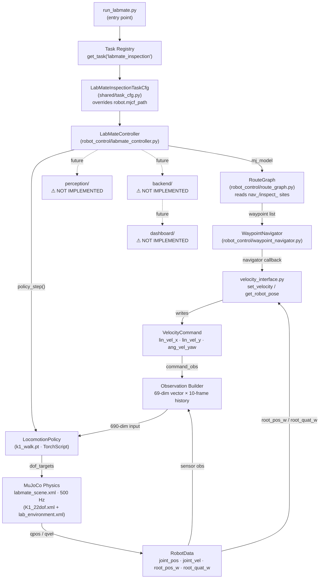

# LabMate — AI-Powered Laboratory Assistant

**RobotHack 2026 · Booster K1 EDU · MuJoCo Simulation**

---

## A. Project Overview

LabMate is a simulation-based robotics application built for **RobotHack 2026** under the challenge *"Let a Robot Assist You."*

The project addresses the challenge of deploying a humanoid robot as an autonomous laboratory assistant. The robot — a **Booster K1 EDU** modelled in MuJoCo — patrols a simulated laboratory, navigates between workstations, pauses to perform inspections, and reports findings.

LabMate is an **application layer** built on top of the official Booster Robotics locomotion system. It does not re-implement walking. Instead it provides high-level navigation, task logic, and (in future milestones) perception, backend services, and a monitoring dashboard on top of the proven Booster walking policy.

### Implemented capabilities

- MuJoCo physics simulation of the Booster K1 (22 DOF, 500 Hz physics).
- Official K1 walking policy (`k1_walk.pt`) running at 50 Hz via TorchScript inference.
- Autonomous waypoint navigation with heading control, position and yaw tolerances, and timed inspection pauses.
- Velocity command interface with hardware-matched limits (forward 1.6 m/s, backward 0.3 m/s, lateral 0.3 m/s, yaw 1.8 rad/s).
- Per-second position and command logging to stdout.

### Planned features (not yet implemented)

- Simulated laboratory environment (workstations, equipment, scene geometry).
- Workstation inspection logic.
- Perception subsystem (OpenCV-based sensor processing).
- Backend REST API (FastAPI).
- Monitoring dashboard (Streamlit).
- Automated tests.

---

## B. System Architecture

### Overview

LabMate is a single-process, single-threaded application. All components run synchronously in the main thread under `MujocoController.run()`. There is no inter-process communication in the current implementation.



### Communication mechanisms

| Interface | Mechanism |
|---|---|
| `run_labmate.py` → `LabMateController` | Direct Python instantiation |
| `LabMateController` → `WaypointNavigator` | Callback: `self.navigator(controller, elapsed)` |
| `WaypointNavigator` → velocity commands | Direct attribute write via `set_velocity()` |
| `LabMateController` → `MujocoController` | Python inheritance + `super()` calls |
| `MujocoController` → MuJoCo | C-extension call (`mujoco.mj_step`) |
| Policy ↔ robot state | Shared in-process `RobotData` object (torch tensors) |
| Backend / Dashboard | **Not connected — no code exists yet** |

---

## C. Repository Structure

```
LabMate/
│
├── run_labmate.py              ← Entry point. Wires task config → controller → navigator.
│
├── robot_control/              ← Custom LabMate application layer (the only custom code).
│   ├── labmate_controller.py   ← Subclasses MujocoController. Disables stdin.
│   │                             Injects navigator callback into policy_step().
│   ├── velocity_interface.py   ← set_velocity(), stop_robot(), get_robot_pose().
│   │                             All high-level commands enter the robot through here.
│   ├── route_graph.py          ← RouteGraph: reads the nav_/inspect_ sites out of the
│   │                             loaded MJCF and plans routes over ROUTE_EDGES (BFS).
│   │                             Single source of truth for route connectivity.
│   └── waypoint_navigator.py   ← WaypointNavigator: state machine for multi-waypoint
│                                 patrol with heading control and inspection pauses.
│
├── simulation/
│   ├── models/                 ← PLANNED. Intended for custom robot model variants.
│   └── scenes/
│       ├── labmate_scene.xml   ← Scene entry point. ← LOADED BY SIM
│       │                         Includes K1_22dof.xml, then lab_environment.xml,
│       │                         and re-points meshdir at the Booster meshes.
│       └── lab_environment.xml ← Laboratory: 15 static bodies, 197 geoms,
│                                 23 sites (9 nav_, 7 inspect_, 7 target_).
│                                 Adds no joints, actuators or DOF.
│
├── backend/                    ← PLANNED. No files yet. (FastAPI)
├── dashboard/                  ← PLANNED. No files yet. (Streamlit)
├── perception/                 ← PLANNED. No files yet. (OpenCV)
├── shared/
│   └── task_cfg.py             ← LabMateInspectionTaskCfg. Registers the
│                                 "labmate_inspection" task: k1_walk with
│                                 robot.mjcf_path pointing at labmate_scene.xml.
├── tests/
│   ├── check_scene.py          ← Static geometric validation of the scene:
│   │                             robot arrays unchanged, site and route clearance.
│   └── test_route_graph.py     ← Asserts generated routes stay on validated edges.
│
├── external/                   ← NOT tracked by LabMate git. Must be placed manually.
│   │                             See Installation section.
│   ├── booster_deploy/         ← Official Booster locomotion + MuJoCo framework.
│   │   ├── booster_deploy/
│   │   │   ├── controllers/
│   │   │   │   ├── base_controller.py      ← BaseController, BoosterRobot, RobotData,
│   │   │   │   │                             VelocityCommand — core abstractions.
│   │   │   │   ├── mujoco_controller.py    ← MujocoController. Loads MJCF, runs
│   │   │   │   │                             physics loop, PD actuator control.
│   │   │   │   └── controller_cfg.py       ← All configuration dataclasses.
│   │   │   ├── robots/
│   │   │   │   └── k1.py                   ← K1_CFG: 22-joint spec, stiffness,
│   │   │   │                                 damping, effort limits, mjcf_path.
│   │   │   └── utils/
│   │   │       ├── policy_runner.py        ← TorchScriptRunner / CpuOnnxRunner.
│   │   │       └── registry.py             ← Task registry (register_task / get_task).
│   │   ├── tasks/
│   │   │   └── locomotion/
│   │   │       ├── locomotion.py           ← LocomotionPolicy, K1LocomotionPolicyCfg.
│   │   │       │                             Observation build, history, inference.
│   │   │       └── robots/k1/__init__.py   ← K1WalkTaskCfg. Registers "k1_walk".
│   │   │                                     Sets checkpoint_path → k1_walk.pt.
│   │   └── scripts/deploy.py               ← Standalone CLI (not used by LabMate).
│   │
│   └── booster_assets/                     ← Official robot models and motion data.
│       ├── robots/K1/K1_22dof.xml          ← MuJoCo MJCF model (22 DOF).
│       │                                     Included by labmate_scene.xml.
│       ├── robots/K1/meshes/               ← 52 STL meshes. Referenced via meshdir.
│       ├── robots/K1/K1_22dof.urdf         ← URDF variant (not used in sim).
│       └── src/booster_assets/__init__.py  ← Provides BOOSTER_ASSETS_DIR constant.
│
├── README.md                   ← This file.
├── AGENTS.md                   ← AI agent development guidelines.
└── .gitignore                  ← Excludes .venv/, external/, *.pt, *.pth, *.onnx.
```

> **Note:** `external/` is excluded from the LabMate git repository. The two Booster repos are placed manually on disk. They are not git submodules and have no pinned version reference in LabMate's history.
>
> **Because `external/` is untracked, no LabMate file may live inside it.** The laboratory scene is LabMate code and is therefore tracked under `simulation/scenes/`. Nothing under `external/` is modified to load it: `shared/task_cfg.py` overrides `robot.mjcf_path` in a LabMate config subclass instead.

---

## D. Technology Stack

All versions verified from the installed `.venv` environment.

| Technology | Version | Role |
|---|---|---|
| Python | 3.12.3 | Primary development language |
| MuJoCo | 4.0.1 | Physics simulation and robot visualization |
| PyTorch | 2.15.0+cpu | TorchScript inference for `k1_walk.pt` |
| NumPy | 1.26.4 | Numerical arrays; MuJoCo ↔ PyTorch bridge |
| SciPy | 1.17.1 | Available; not currently used by LabMate |
| booster_assets | 1.0.0 | Robot MJCF models; provides `BOOSTER_ASSETS_DIR` |
| Booster Deploy | local (unversioned) | Locomotion framework; `MujocoController`, `LocomotionPolicy` |
| FastAPI | 0.165.0 | Planned backend REST API (installed, not wired) |
| Streamlit | 1.67.0 | Planned dashboard UI (installed, not wired) |
| OpenCV (`opencv-python`) | 4.11.0.86 | Planned perception (installed, not wired) |
| PyYAML | 6.0.4 | Available; not currently used by LabMate |
| ONNX Runtime | — | Optional; needed only for `.onnx` policy checkpoints |

> **GPU note:** PyTorch is installed as the CPU-only build (`2.15.0+cpu`). All policy inference runs on CPU. The `task_cfg.policy.device = "cpu"` setting in `run_labmate.py` reflects this.

---

## E. Installation and Environment Setup

### Prerequisites

- **Linux** (tested). MuJoCo passive viewer requires a display (physical or virtual framebuffer).
- Python 3.12.
- Git.

### 1. Clone LabMate

```bash
git clone https://github.com/marcravel/labmate.git
cd LabMate
```

### 2. Place external Booster repositories

The `external/` directory is excluded from LabMate's git history. You must clone both Booster repos manually:

```bash
mkdir -p external

# Official Booster robot models (MJCF, URDF, motion data)
git clone https://github.com/BoosterRobotics/booster_assets.git external/booster_assets

# Official Booster deployment framework (locomotion policy, MuJoCo controller)
git clone https://github.com/BoosterRobotics/booster_deploy.git external/booster_deploy
```

### 3. Create and activate the virtual environment

```bash
python3.12 -m venv .venv
source .venv/bin/activate
```

### 4. Install dependencies

Install the core simulation and application dependencies:

```bash
pip install mujoco torch numpy scipy pyyaml fastapi streamlit opencv-python
```

Install the Booster Deploy runtime dependencies:

```bash
pip install -r external/booster_deploy/requirements.txt
```

Install the `booster_assets` Python package (editable install):

```bash
pip install -e ./external/booster_assets
```

### 5. Verify the K1 walking policy checkpoint

The checkpoint file is excluded from git (`*.pt` is in `.gitignore`). Verify it is present:

```bash
ls external/booster_deploy/tasks/locomotion/robots/k1/models/k1_walk.pt
```

If the file is missing, it must be obtained separately from the Booster team or via the `booster_deploy` repository release assets.

### 6. Environment variables

There are no `.env` files and no required environment variables for the current implementation. The `BOOSTER_ASSETS_DIR` path is resolved automatically by the `booster_assets` Python package at import time.

---

## F. Running the Application

### Prerequisites

- Virtual environment activated: `source .venv/bin/activate`
- Working directory: repository root (`LabMate/`)
- Display available (MuJoCo viewer requires a GUI or virtual framebuffer)

### Run the autonomous patrol simulation (current entry point)

```bash
python run_labmate.py
```

This launches the MuJoCo viewer and starts the K1 robot patrolling the laboratory. The route is not hard-coded: `RouteGraph` reads the `nav_*` and `inspect_*` sites out of the loaded scene and plans a round visiting all seven inspection stations, so the route can only use positions the model declares. Expected output:

```
============================================================
  LabMate - Autonomous Laboratory Inspection Patrol
============================================================
Route: 23 waypoints, 7 inspection stations
  - inspect_central_table
  - inspect_electronics_a
  - inspect_electronics_b
  - inspect_server_rack
  - inspect_storage
  - inspect_printer
  - inspect_robotics_bench
Launching autonomous patrol...
[MuJoCo] Controls: Space=pause/resume.
[  1.0s] Pos: X=0.12, Y=0.00 | Cmd: vx=0.40, vy=0.00, yaw=0.00
...
[Navigator] ARRIVED at inspect_central_table! Pausing 3.0s for inspection...
```

Controls during simulation:
- **Space** — pause / resume physics.
- Close the viewer window to exit.

### Run the official Booster Deploy standalone simulation (without LabMate)

This is the original Booster entry point. Use it only for debugging the official policy directly:

```bash
cd external/booster_deploy
python scripts/deploy.py --task k1_walk --mujoco --device cpu
```

Velocity commands are entered at the terminal prompt: `x y yaw` (e.g., `0.4 0.0 0.0`).

### Backend (planned — not yet runnable)

`backend/` is empty. No server exists yet.

### Dashboard (planned — not yet runnable)

`dashboard/` is empty. No dashboard exists yet.

### Tests

Both test scripts are standalone (no pytest dependency) and exit non-zero on failure.

```bash
# Static geometric validation of the scene. Takes a few minutes: it sweeps every
# site at 24 headings and every route edge, both directions, at 2 cm intervals.
python tests/check_scene.py

# Route planning: asserts generated routes only use validated edges. Fast.
python tests/test_route_graph.py
```

`check_scene.py` verifies that the laboratory adds no robot state — that every robot array is identical and in the same ID slot as in the bare `K1_22dof.xml` — and that the navigation graph is collision-free. **Run it after any change to `simulation/scenes/`.** It does not run the walking policy.

---

## G. Robot Control Architecture

### Layer separation

The control pipeline has two distinct layers:

**Layer A — Official low-level locomotion (Booster Deploy, do not modify)**

1. `K1WalkTaskCfg` registers the `"k1_walk"` task with its full configuration.
2. `LocomotionPolicy.__init__` loads `k1_walk.pt` via `torch.jit.load` and extracts the `.actor` submodule.
3. `MujocoController.__init__` loads `K1_22dof.xml` into MuJoCo and initializes the physics data.
4. Each control cycle (50 Hz):
   - `update_state()` reads `mj_data.qpos` / `mj_data.qvel` → stores as torch tensors in `RobotData`.
   - `LocomotionPolicy.compute_observation()` assembles a 69-dimensional observation vector.
   - The 10-frame history buffer is rolled and the new observation appended → 690-dimensional input.
   - The actor network runs inference → 20-dimensional raw action tensor.
   - Action is scaled (`× 0.25`), filtered (`lerp α=0.8`), mapped to 22 real joints → `dof_targets`.
   - `ctrl_step()` applies PD control 10× at 500 Hz: `ctrl = clip(kp·(target−pos) − kd·vel, ±effort_limit)`.

**Layer B — Custom LabMate high-level logic (robot_control/, modify freely)**

1. `LabMateController` overrides `update_vel_command()` with `pass` (disables terminal stdin).
2. `LabMateController.policy_step()` calls `self.navigator(controller, elapsed)` before invoking the official policy.
3. `WaypointNavigator.update()` computes heading error and distance to the current waypoint, then calls `set_velocity()`.
4. `set_velocity()` writes clamped values to `controller.vel_command.lin_vel_x/y/ang_vel_yaw`.
5. The velocity command is then included in the next observation by the official policy.

### Observation vector structure (per step, 69 dimensions)

| Slice | Size | Content |
|---|---|---|
| `[0:3]` | 3 | Base angular velocity in body frame (`root_ang_vel_b`) |
| `[3:6]` | 3 | Projected gravity vector in body frame |
| `[6:9]` | 3 | Velocity command `[lin_vel_x, lin_vel_y, ang_vel_yaw]` |
| `[9:29]` | 20 | Joint position error (mapped 20 policy joints − defaults) |
| `[29:49]` | 20 | Joint velocities × 0.1 (obs_dof_vel_scale) |
| `[49:69]` | 20 | Last action (previous policy output) |

History buffer: 10 frames → flattened to **690-dimensional** actor input.

### Velocity command limits

| Axis | Parameter | Limit | Source |
|---|---|---|---|
| Forward (x ≥ 0) | `vx_forward_max` | 1.6 m/s | `K1WalkControllerCfg` |
| Backward (x < 0) | `vx_backward_max` | 0.3 m/s | `K1WalkControllerCfg` |
| Lateral | `vy_max` | ±0.3 m/s | `K1WalkControllerCfg` |
| Yaw | `vyaw_max` | ±1.8 rad/s | `K1WalkControllerCfg` |

`set_velocity()` enforces these limits. Do not write to `vel_command` attributes directly.

### Integration point for future high-level commands

The **only safe integration point** for new application-level behavior is `vel_command` via `set_velocity()`:

```python
from robot_control.velocity_interface import set_velocity, stop_robot

set_velocity(controller, vx=0.3, vy=0.0, yaw=0.0)   # move forward
stop_robot(controller)                                  # stop
```

Do not call `policy.inference()`, `ctrl_step()`, or write to `robot.data` from application code.

### Key configuration parameters

| Parameter | Value | Meaning |
|---|---|---|
| `policy_dt` | 0.02 s | Policy runs at 50 Hz |
| `physics_dt` | 0.002 s | Physics runs at 500 Hz |
| `decimation` | 10 | Physics steps per policy step |
| `action_scale` | 0.25 | Raw action → joint angle multiplier |
| `action_filter` | 0.8 | Low-pass lerp factor (0 = frozen, 1 = unfiltered) |
| `actor_obs_history_length` | 10 | Frames of observation history fed to actor |
| `obs_dof_vel_scale` | 0.1 | Joint velocity normalization factor |
| `enable_safety_fallback` | True | Stops controller if fall detected (`gravity_z > −0.5`) |
| `arm_action_fix_offset` | 0.2 | Constant offset subtracted from right elbow pitch action |
| `init_pos` | `[0, 0, 0.6]` | Robot spawn position (x=0, y=0, z=0.6 m) |

---

## H. Current Implementation Status

| Subsystem | Status | Description |
|---|---|---|
| MuJoCo physics simulation | ✅ Implemented | 500 Hz physics loop; `labmate_scene.xml` loaded; PD actuator control. |
| K1 robot model | ✅ Implemented | 22-DOF MJCF loaded from booster_assets. Full joint/body hierarchy. |
| Official walking policy | ✅ Implemented | `k1_walk.pt` loaded via TorchScript. 50 Hz inference. Unmodified. |
| Velocity command interface | ✅ Implemented | `set_velocity()`, `stop_robot()`, `get_robot_pose()` in `velocity_interface.py`. |
| Lab environment (scene) | ✅ Implemented | `simulation/scenes/`: 15 static bodies, 197 geoms, 7 inspection stations. Adds no DOF. |
| Navigation graph | ✅ Implemented | `RouteGraph` reads `nav_*`/`inspect_*` sites from the model; BFS over `ROUTE_EDGES`. |
| Waypoint navigator | ✅ Implemented | `WaypointNavigator`: closed-loop heading control during approach, position + yaw tolerance, inspection pause. |
| Navigator ↔ controller integration | ✅ Implemented | Callback pattern wired in `run_labmate.py`. |
| Shared config | ✅ Implemented | `shared/task_cfg.py` only: the task config override. No shared schemas yet. |
| Automated tests | ✅ Implemented | `tests/check_scene.py`, `tests/test_route_graph.py`. Standalone scripts, no pytest. |
| Camera / image acquisition | ⬜ Planned | No `<camera>` exists in any MJCF. The K1 head carries empty mount frames only. |
| Inspection logic | ⬜ Planned | No code exists in any module. |
| Perception subsystem | ⬜ Planned | `perception/` is empty. OpenCV is installed but unused. |
| Backend API | ⬜ Planned | `backend/` is empty. FastAPI is installed but unused. |
| Dashboard UI | ⬜ Planned | `dashboard/` is empty. Streamlit is installed but unused. |
| Dependency declarations | ⚠ Missing | No `requirements.txt` or `pyproject.toml` at the LabMate root. |

---

## I. Known Limitations and Roadmap

### Current limitations

- **No lab environment.** The simulation runs in an empty MuJoCo world. `simulation/scenes/` has no content.
- **No inspection logic.** The navigator pauses at waypoints but performs no actual inspection.
- **Single-threaded blocking loop.** `MujocoController.run()` runs synchronously with `sleep()`. Connecting a backend server will require threading or multiprocessing. `vel_command` and `robot.data` have no thread locks and will need protection before cross-thread access is introduced.
- **No test coverage.** There are no automated tests for any LabMate module.
- **No root dependency file.** Environment reproducibility depends on the untracked `.venv`. New contributors must install packages manually.
- **External repos not submoduled.** `external/booster_deploy` and `external/booster_assets` have no pinned version in LabMate's git history.
- **Safety fallback has no recovery.** If the robot falls (`enable_safety_fallback=True`), the controller stops and the viewer closes. There is no auto-recovery or restart.
- **Navigator `is_finished` has no reset.** To re-run the patrol, a new `WaypointNavigator` instance must be created.

### Recommended next implementation priorities

1. **Add `requirements.txt`** at the LabMate root listing all required packages.
2. **Create a lab scene MJCF** at `simulation/scenes/lab_scene.xml` with workstation geometry that includes `K1_22dof.xml`. Do not modify the original model file.
3. **Add inspection logic** in `perception/workstation_inspector.py` triggered at the waypoint pause event.
4. **Add threading** to `run_labmate.py` and protect `vel_command` with a lock before connecting the backend.
5. **Create the FastAPI backend** at `backend/app.py` exposing `/status` and `/inspections` endpoints.
6. **Create the Streamlit dashboard** at `dashboard/app.py` polling the backend.
7. **Add unit tests** for `velocity_interface.py` clamping and `WaypointNavigator` state machine.

---

## J. Contribution Guidelines

### Where new functionality belongs

| Functionality | Location |
|---|---|
| New high-level navigation behaviors | `robot_control/waypoint_navigator.py` or new files in `robot_control/` |
| Inspection and sensor logic | `perception/` (new files) |
| Application API endpoints | `backend/` (new files) |
| Dashboard UI | `dashboard/` (new files) |
| Shared config dataclasses | `shared/` (new files) |
| Lab environment models | `simulation/scenes/` (MJCF files) |
| Robot model variants | `simulation/models/` |
| **Never** | `external/booster_deploy/` or `external/booster_assets/` |

### How velocity commands should be issued

All motion commands must go through `set_velocity()` in `robot_control/velocity_interface.py`. Do not write to `controller.vel_command` attributes directly, as this bypasses limit clamping.

### How to avoid breaking the control pipeline

- Do not override `ctrl_step()`, `update_state()`, or `BaseController.policy_step()`.
- Do not modify `LocomotionPolicy`, `K1LocomotionPolicyCfg`, or `K1WalkTaskCfg`.
- Do not add non-trivial logic inside `LabMateController.update_vel_command()` — it is intentionally a no-op.
- Keep the navigator callable signature as `update(controller, elapsed_time)`.

### Running tests

No automated tests exist yet. When tests are added, run them with:

```bash
python -m pytest tests/
```

### Documentation update expectations

- Update `README.md` if the architecture, entry point, or setup instructions change.
- Update `AGENTS.md` if source-of-truth ownership changes.
- Keep command examples and file paths accurate. Do not document planned features as working.

---

## Project Information

| Field | Value |
|---|---|
| **Event** | RobotHack 2026 |
| **Robot** | Booster K1 EDU |
| **Primary simulation** | MuJoCo 4.0.1 |
| **Repository** | https://github.com/marcravel/labmate |
